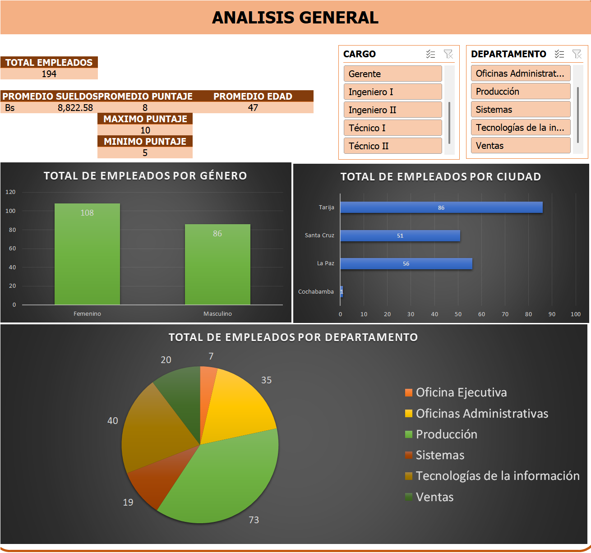

# Análisis de personal en Excel | ROWELL S.A.

Cuadro de mando de recursos humanos realizado como trabajo final guiado del curso de Excel avanzado. Construí el informe con Power Query, tablas dinámicas, gráficos y segmentadores para explorar una base ficticia de empleados, sueldos y evaluaciones. El libro incluye una vista general y otra de detalle.

## Problema

¿Cómo consultar en un solo informe la distribución del personal, sus sueldos y sus evaluaciones, y filtrar los resultados por cargo, departamento, edad o jefe? El destinatario del ejercicio es una persona que necesita explorar los datos de recursos humanos sin revisar tres tablas separadas.

## Datos

El ejercicio utiliza tres CSV de práctica entregados en el curso y reutilizados en otro curso de Power BI. Los registros representan empleados ficticios de ROWELL S.A.; no describen una empresa ni una plantilla real. Cada archivo contiene 194 filas y se une con los demás por `ID_EMPLEADO`:

| Archivo | Contenido principal |
| --- | --- |
| [`Tabla empleados.csv`](data/Tabla%20empleados.csv) | Nombre, ciudad, fecha de nacimiento, sexo, departamento, cargo y jefe |
| [`Tabla Sueldo.csv`](data/Tabla%20Sueldo.csv) | Sueldo por empleado |
| [`Tabla evaluación.csv`](data/Tabla%20evaluaci%C3%B3n.csv) | Puntaje de evaluación por empleado |

Los CSV no incluyen una fecha de corte de la plantilla. La [nota de datos](data/README.md) explica el formato y las columnas.

## Método y herramientas

Importé los CSV con **Power Query**, combiné las tres tablas mediante `ID_EMPLEADO` y construí tablas dinámicas, gráficos y segmentadores en **Microsoft Excel**. La vista general resume indicadores y distribuciones; la vista de detalle permite explorar sueldos, edades y puntuaciones con otros filtros.

**Habilidades técnicas aplicadas:** importación y transformación de CSV, combinación de tablas por clave, tablas dinámicas, agregaciones, gráficos de distribución y segmentadores interactivos.

## Resultados

- El informe reúne **194 empleados ficticios**: 108 mujeres y 86 hombres.
- El sueldo total registrado es **Bs 1.711.581** y el promedio es **Bs 8.822,58** por empleado.
- Producción reúne **73 empleados**; Tecnologías de la información, **40**. Son los dos departamentos más numerosos de este conjunto de práctica.

Estos resultados describen únicamente los registros del ejercicio. No sustentan conclusiones sobre una empresa real ni recomendaciones de personal.

## Mi contribución

El trabajo partió de una consigna guiada y de datos proporcionados en el curso. Construí mi propio libro: integré las tablas, organicé las vistas y preparé los indicadores, gráficos y filtros.

## Aprendizajes

Aprendí a relacionar datos de personal, sueldos y evaluaciones por una clave común y a convertir las tablas resultantes en un informe navegable. Si lo repitiera, conservaría los puntajes con sus decimales y comprobaría las etiquetas y rutas de origen antes de entregar el libro.

## Abrir y actualizar el informe

Descarga [`dashboard-personal-excel.xlsx`](dashboard-personal-excel.xlsx) y ábrelo con Microsoft Excel de escritorio para ver las tablas dinámicas y usar los segmentadores. El libro conserva los resultados guardados. Para **actualizar** los datos, cambia en Power Query la ruta de origen de cada una de las tres consultas para que apunte a los CSV de [`data/`](data/) en tu equipo y después usa **Actualizar todo**.

El libro convierte los puntajes de evaluación a números enteros durante la importación; por eso los indicadores y gráficos de evaluación reflejan valores redondeados. Los CSV conservan los puntajes originales con decimales. La edad corresponde al cálculo guardado en el libro y no debe interpretarse como edad actual.
